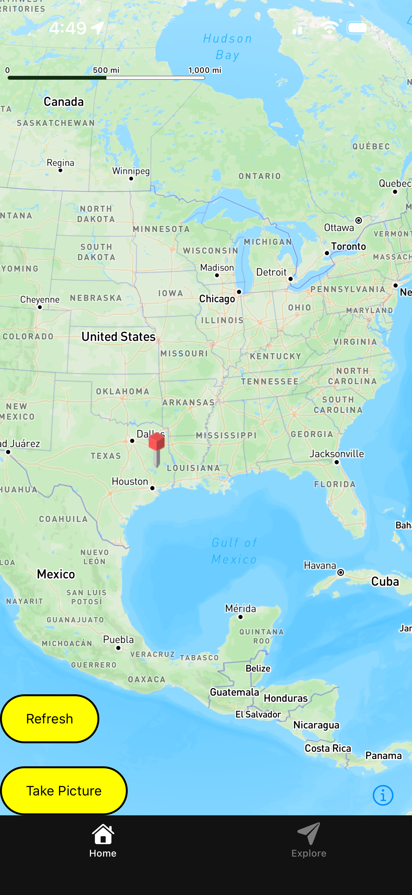
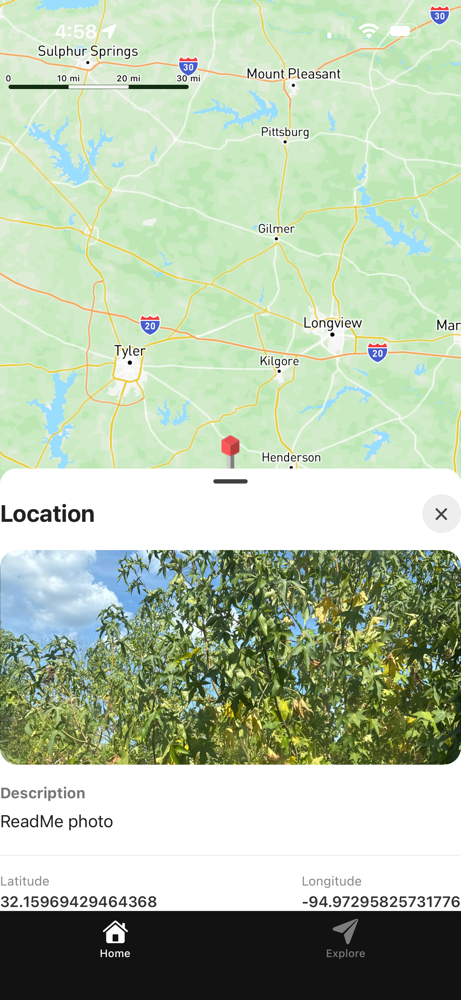
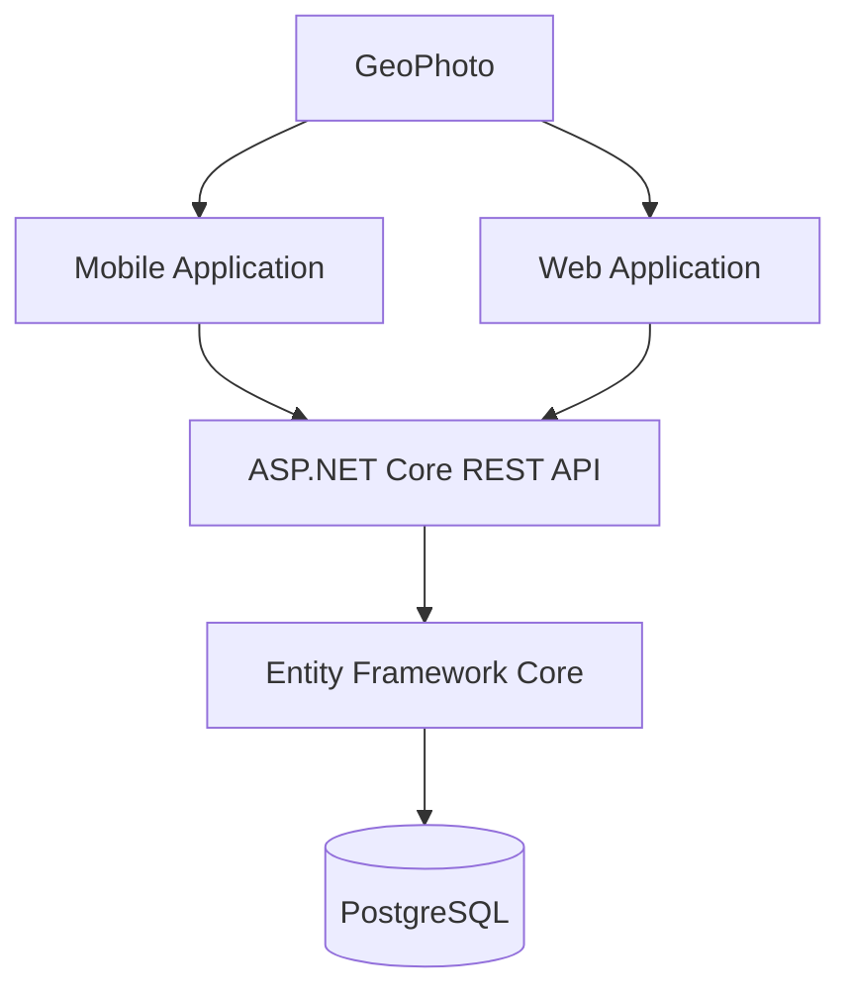

# 📍 GeoPhoto

GeoPhoto is a location-based photo-sharing application built around a simple idea: connecting photographs to the places where they were taken.

Users can explore photos through an interactive map, discover locations shared by others, and contribute their own photos using the camera and GPS capabilities of a mobile device.

The project includes a React web application, a React Native mobile application, and a centralized ASP.NET Core backend connected to a PostgreSQL database.

**Project Type:** Personal Full-Stack Project  
**Status:** Developed as an ongoing portfolio project

---

## 📸 Screenshots & Demonstrations

Screenshots and demonstrations will be added here as the portfolio presentation is finalized.

### Mobile Application



### Location Details



### Web Application

*Screenshots coming soon.*

### Live Demo & Downloads

- **Website:** Coming soon
- **Mobile Installation:** Coming soon
- **Demo Video:** Coming soon

---

## ✨ Features

GeoPhoto brings together map-based exploration, photo sharing, and social features.

### Maps & Location Discovery
- Interactive map with geographic photo pins
- Browse locations shared by other users
- Select individual locations to view their content
- Explore locations through different discovery and filtering options

### Photo Sharing
- Capture photos using a mobile device
- Associate photos with geographic coordinates
- Upload location-based content through the backend API
- View shared photos and their associated locations

### User Features
- User registration and authentication
- User profiles
- Like and bookmark locations
- View and post comments
- Browse personal posts and saved locations

### Cross-Platform Applications
- React web application
- React Native mobile application
- Shared backend and database for both platforms

---

## 🛠️ Technology Stack

| Area | Technologies |
|---|---|
| Mobile | React Native, Expo, Expo Router, TypeScript |
| Web | React, Vite, JavaScript, HTML, CSS |
| Backend | C#, ASP.NET Core Web API |
| Database | PostgreSQL |
| ORM | Entity Framework Core, Npgsql |
| Maps | Mapbox |
| Authentication | ASP.NET Core Identity, JWT |
| Development | Git, GitHub, Visual Studio, VS Code, pgAdmin |

---

## 🏗️ Architecture

GeoPhoto uses a centralized backend architecture. The mobile and web applications operate as separate clients while sharing the same API and database.



### Frontend Applications

**Mobile — React Native & Expo**

The mobile application provides access to GeoPhoto's location and photo-sharing functionality. It uses device capabilities such as the camera and GPS to associate photographs with geographic coordinates.

**Web — React & Vite**

The web application provides a larger interface for exploring the map, browsing locations, and interacting with shared content.

Both applications communicate with the same backend rather than maintaining separate application data.

### Backend — ASP.NET Core

The backend is built with C# and ASP.NET Core Web API.

It handles application requests, authentication, authorization, and communication with the database. The API acts as the central point through which the frontend applications access application data.

### Database — PostgreSQL & Entity Framework Core

PostgreSQL provides persistent storage for GeoPhoto's application data.

Entity Framework Core serves as the ORM, allowing database entities to be represented as C# objects and queried through the application's data context.

EF Core migrations are used to manage changes to the database schema as the application evolves.

---

## 📍 How Location Sharing Works

One of GeoPhoto's central features is connecting a photograph to its geographic location.

The general workflow is:

1. A user captures a photograph using the mobile application.
2. The application obtains the device's geographic coordinates.
3. The photo and associated location information are submitted to the backend.
4. The ASP.NET Core API processes the request.
5. Entity Framework Core communicates with PostgreSQL.
6. The saved location can be retrieved by the frontend applications and displayed on the map.

This makes geographic information part of the application's stored content, allowing users to explore photographs through their locations.

---

## 🔐 Authentication & Data Management

GeoPhoto uses ASP.NET Core Identity and JWT-based authentication to support user accounts and protected application functionality.

The backend is responsible for controlling access to protected operations, while the frontend applications communicate with the API through HTTP requests.

Both clients share the same backend services and database, providing a consistent application experience across platforms.

Sensitive configuration, including database credentials and authentication secrets, should be supplied through local environment-specific configuration rather than committed to the repository.

---

## 🚀 Getting Started

GeoPhoto is organized as a single repository containing three separate projects.

### Prerequisites

- Node.js and npm
- .NET SDK
- PostgreSQL
- Git
- Visual Studio or Visual Studio Code
- An Expo-compatible device or emulator for mobile development

### 1. Clone the Repository

```bash
git clone <repository-url>
cd GeoPhoto
```

### 2. Backend — ASP.NET Core API

Navigate to the API project:

```powershell
cd GeoPhoto-API
```

Restore dependencies:

```powershell
dotnet restore
```

Configure the PostgreSQL connection string and other required application settings locally.

Apply database migrations:

```powershell
dotnet ef database update
```

Start the API:

```powershell
dotnet run
```

### 3. Web — React & Vite

Open a separate terminal and navigate to the web project:

```powershell
cd GeoPhoto-Web
```

Install dependencies:

```powershell
npm install
```

Start the development server:

```powershell
npm run dev
```

Vite will provide a local address where the web application can be accessed.

### 4. Mobile — React Native & Expo

Open another terminal and navigate to the mobile project:

```powershell
cd GeoPhoto-Mobile
```

Install dependencies:

```powershell
npm install
```

Start the Expo development server:

```powershell
npx expo start
```

The application can then be opened using an Expo-compatible physical device or emulator.

**Note:** The API address, database connection string, authentication configuration, and other environment-specific settings must be configured for your local environment. Do not commit credentials or private API keys to GitHub.

---

## 💡 Development & Technical Focus

Building GeoPhoto has involved working across several areas of software development:

- Designing and implementing REST API endpoints
- Building separate web and mobile frontend applications
- Managing relational data with PostgreSQL
- Using Entity Framework Core for database access and migrations
- Implementing authentication and authorization
- Integrating geographic coordinates and interactive maps
- Working with device camera and location permissions
- Connecting frontend applications to backend services
- Organizing a multi-project Git repository

The goal has been to build one cohesive application rather than three disconnected projects.

---

## 🔮 Future Improvements

Some areas I'd like to continue improving include:

- Expanding automated test coverage
- Improving error handling and validation
- Refining the map and location discovery experience
- Improving photo storage and management
- Expanding API functionality
- Continuing deployment and infrastructure improvements

---

## 👨‍💻 About the Project

GeoPhoto started as an opportunity to build something more substantial than an isolated programming exercise.

I wanted to work on a project that involved multiple parts of software development: designing interfaces, building APIs, managing a database, integrating device functionality, and connecting everything into a working application.

It has grown into a cross-platform project that brings together the technologies I've been working with across web, mobile, and backend development.